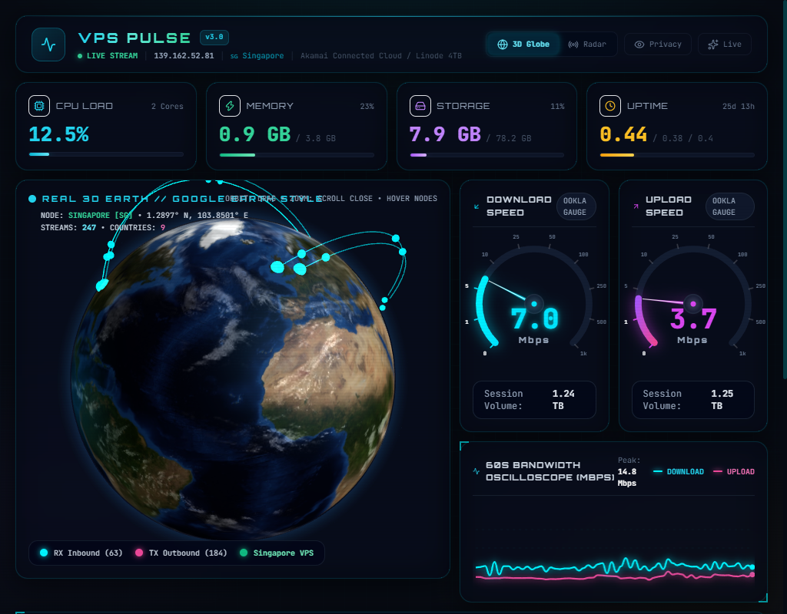
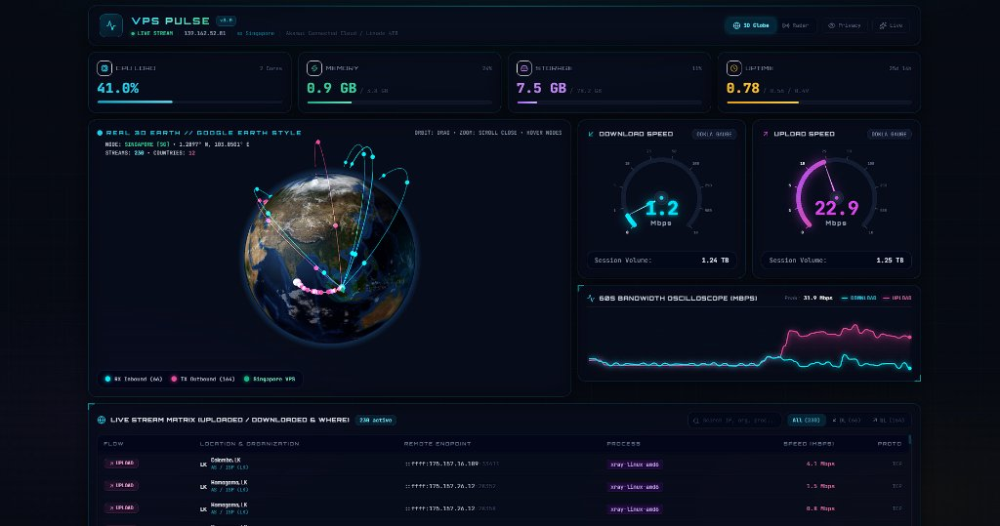

<h1 align="center">VPS Pulse ⚡</h1>

<p align="center">
  Real-time Linux VPS telemetry dashboard & interactive 3D planetary network visualizer.<br>
  Transforms live kernel metrics and active socket connections into an immersive, hardware-accelerated command center.
</p>

<p align="center">
  
  
  
  
  
  
  <a href="LICENSE"></a>
</p>

<p align="center">
  <strong>Made by Ace</strong> · <a href="https://t.me/Aceddev">@Aceddev</a> · <a href="mailto:Acedevmc@gmail.com">Acedevmc@gmail.com</a>
</p>

---

## 📸 Interface Previews

<p align="center">
  
</p>

<p align="center">
  
</p>

---

## ⚡ One-Command VPS Installation

Deploy instantly to any Ubuntu, Debian, CentOS, AlmaLinux, or Rocky Linux VPS:

```bash
curl -sSL https://raw.githubusercontent.com/acedev0/vps-pulse/main/install.sh | bash
```

The script automatically detects your operating system, configures dependencies (Node.js 20 LTS, git, build essentials), launches an interactive CLI setup wizard, compiles the dashboard, and configures an auto-restarting systemd background service with firewall rules.

---

## 🧙‍♂️ Interactive Setup Wizard

The installer walks you through a streamlined configuration wizard directly in your terminal:

```text
 ══════════════════════════════════════════════════════════════
    VPS PULSE // INTERACTIVE SETUP WIZARD
 ══════════════════════════════════════════════════════════════

 [1/4] Web Dashboard & Telemetry Port
       Enter port to run VPS Pulse on [default: 7777]: 7777
       ✓ Configured port: 7777

 [2/4] Node Display Name
       Enter custom server label [default: my-vps]: Primary-Edge-01
       ✓ Configured node name: Primary-Edge-01

 [3/4] Public IP & Location Anchor
       Auto-detected Public IP: 139.162.52.81
       Press Enter to keep, or enter custom IP/domain: 
       ✓ Configured host IP: 139.162.52.81

 [4/4] Process Manager
       1) systemd background service (Recommended, auto-restart on boot)
       2) PM2 process manager
       Select option [1]: 1

 ╔════════════════════════════════════════════════════════════════╗
 ║              ⚡ VPS PULSE INSTALLED SUCCESSFULLY!              ║
 ╚════════════════════════════════════════════════════════════════╝

 🌐 Web Dashboard URL:  http://139.162.52.81:7777
```

---

## 🛠️ Management Command (`vpspulsectl`)

VPS Pulse installs the `vpspulsectl` control CLI into `/usr/local/bin/` for effortless server maintenance:

```text
vpspulsectl status       View real-time service status & uptime
vpspulsectl logs         Follow live telemetry broadcast logs
vpspulsectl restart      Gracefully restart the backend server
vpspulsectl stop         Stop background telemetry engine
vpspulsectl start        Start background telemetry engine
vpspulsectl port [N]     Switch web port instantly & update firewall
vpspulsectl update       Fetch latest version from GitHub & rebuild
vpspulsectl uninstall    Completely remove VPS Pulse and services
```

*Example: Switch web port in one second:*
```bash
sudo vpspulsectl port 8080
```

---

## ✨ Features

- 🌍 **Photorealistic 3D Earth Visualizer**
  - High-resolution planetary textures with bump mapping and atmospheric rim glow.
  - Independent rotating cloud atmospheric layer.
  - **Great-Circle SLERP Geodesic Arcs**: Calculates true spherical curvature between remote IP endpoints and the VPS node without chord clipping or subterranean sagging.
  - Interactive camera orbit, zoom controls, and responsive coordinate node tooltips.

- ⏱️ **Precision Speedometer Gauges (Mbps)**
  - Dual gauge cluster for real-time Inbound (Download) and Outbound (Upload) throughput.
  - Non-linear logarithmic dial scaling (`0` to `1,000+ Mbps`) for ultra-responsive reading at both low and high bandwidth saturations.
  - Cumulative session volume tracking in Gigabytes and Terabytes.

- 📈 **60-Second Real-Time Bandwidth Oscilloscope**
  - Smooth Bezier-interpolated dual-trace canvas oscilloscope (Cyan for Download, Magenta for Upload).
  - Dynamic peak scaling and instantaneous rate measurement.

- 🖥️ **Hardware Vitals HUD**
  - Real-time CPU core utilization.
  - Physical RAM consumption and swap state.
  - Root storage filesystem capacity and mount status.
  - System uptime counter and Linux 1/5/15-minute load averages.

- 🌐 **Live Socket & ASN Matrix**
  - Inspects active established TCP/UDP sockets directly from the kernel.
  - Displays remote endpoints, process names, system PIDs, country flags, and geographic locations.
  - Instant filtering by traffic flow (All, Inbound, Outbound) or search query.

---

## 🏗️ Architecture

```mermaid
flowchart TD
    subgraph Host["Linux Kernel (/proc & ss)"]
        P1["/proc/stat (CPU load)"]
        P2["/proc/meminfo (RAM/Swap)"]
        P3["/proc/net/dev (Network delta)"]
        P4["ss -tupn (Active sockets)"]
    end

    subgraph Backend["VPS Pulse Engine (Node.js)"]
        C1["System & Disk Collector"]
        C2["Network Rate Poller (bytes/s)"]
        C3["Socket Inspector & PID Resolver"]
        G1["Offline GeoIP & ASN Engine"]
        WS["Low-Latency WebSocket Server (500ms)"]
    end

    subgraph Client["Hardware-Accelerated Frontend (React + Vite)"]
        GL["Three.js 3D Globe with SLERP Arcs"]
        SP["Logarithmic Speedometer Gauges (Mbps)"]
        OS["Canvas Oscilloscope Waveform Trace"]
        MT["Live Socket Matrix & Filter"]
    end

    Host -->|Direct Kernel Reads| Backend
    Backend -->|Streaming JSON Frame| WS
    WS -->|WebSocket (ws://host:port/ws)| Client
```

---

## ⚙️ Manual Installation & Development

If you prefer building manually without the automated installer:

```bash
git clone https://github.com/acedev0/vps-pulse.git /opt/vps-pulse
cd /opt/vps-pulse

# Install dependencies and build client
npm install
npm run build

# Start server
npm start
```

---

## 🐳 Docker Deployment

Run with Docker Compose:

```bash
git clone https://github.com/acedev0/vps-pulse.git
cd vps-pulse
docker compose up -d
```

---

## 🔒 Configuration Variables

Configuration is loaded from `/etc/vps-pulse/vps-pulse.env` (or local `.env`):

| Variable | Default | Description |
|---|---|---|
| `PORT` | `7777` | Web dashboard & WebSocket listening port |
| `NODE_NAME` | `$(hostname)` | Custom label displayed on dashboard HUD |
| `HOST_IP` | Auto-detected | Public IP address for geographic pinning |
| `HOST_CITY` | Auto-detected | City name override |
| `HOST_COUNTRY` | Auto-detected | Country code override (e.g. `US`, `SG`, `DE`) |
| `DEMO_MODE` | `false` | Enable synthetic traffic simulator for local testing |

---

## 📄 License

Released under the [MIT License](LICENSE). Copyright © 2026 Ace.
